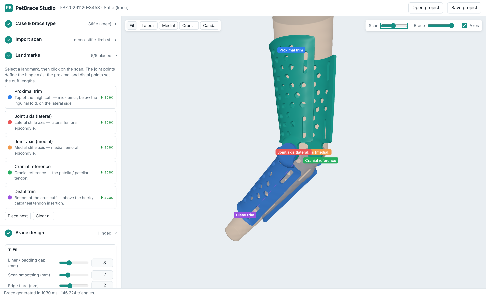

# PetBrace Studio

3D design software for **custom 3D-printed veterinary orthopedic braces**: stifle (knee), hock (tarsus) and carpal (wrist).
Import a 3D scan of the limb, place five anatomical landmarks, tune the design, and export watertight, print-ready STL files plus a printable work order.



## Quick start

```bash
npm install
npm run dev        # http://localhost:5173
npm test           # geometry test suite (vitest)
npm run build      # static build in dist/ — can be hosted anywhere or wrapped in Electron/Tauri
```

No scanner file to hand? Click **Demo limb → Stifle / Hock / Carpal** in step 2 to load a synthetic canine limb with landmarks already placed.

## Clinical workflow

| Step | What happens |
|---|---|
| 1. Case & brace type | Patient, owner, clinic, diagnosis, limb side. Choosing stifle / hock / carpal loads that brace type's default design. |
| 2. Import scan | STL, OBJ or PLY from any handheld or structured-light scanner (e.g. Revopoint, Einscan, iPhone LiDAR apps). Units are auto-detected (mm/cm/m/in), vertices are welded and scan debris (floor, hair, other limb) is removed. |
| 3. Landmarks | Click 5 points on the scan: proximal trim, lateral and medial joint axis (the hinge axis), a cranial reference, and distal trim. Anatomical hints are shown for each brace type (e.g. femoral epicondyles for the stifle, malleoli for the hock, styloid processes for the carpus). |
| 4. Brace design | Liner gap, smoothing, edge flare, wall thickness, trim offsets and tilt, hinged or rigid joint, hinge tab size, rivet hole, clearance, donning opening position and width, straps, ventilation holes. Updates live. |
| 5. Relief & pressure zones | Click bony prominences (patella, calcaneus, accessory carpal pad…) to lift the shell (+mm), or add compression zones (−mm) for suspension. |
| 6. Review & export | Volume and mass per part for PETG / PA12 / PLA / TPU, watertight check, per-part or combined STL (optionally oriented upright on the build plate), printable work order, and a project file with the scan embedded. |

## How the geometry engine works

Limbs are roughly tubular, so each cuff is modelled in a **cylindrical parameterisation around its own segment axis**, the approach many prosthetics and orthotics CAD tools use:

1. **Frames** (`src/core/frames.ts`): the joint centre is the midpoint of the lateral and medial joint landmarks, and the hinge axis runs between them. Segment centres are found by iteratively ray-casting each landmark's cross-section and taking the centroid. Each cuff gets a right-handed frame with θ = 0 pointing cranially.
2. **Radial sampling** (`src/core/brace.ts`): BVH-accelerated rays from the axis give a skin-radius grid r(h, θ). Outliers (rays that leak through scan holes) are rejected, gaps are filled and the grid is Gaussian-smoothed.
3. **Inner surface**: skin + liner gap + relief bumps + edge flare. With a hinge, the area around the hinge axis is replaced by **flat pads perpendicular to the axis**. The distal pad sits outside the proximal pad (boss thickness + clearance), so the two overlap and pivot on a rivet or Chicago screw.
4. **Material field** f(h, θ) in mm: trim band (with tilt), hinge tabs and necks, donning opening, strap slots, rivet hole and staggered ventilation holes. Holes are only placed where the shell is solid enough.
5. **Solid** (`src/core/shell.ts`): marching squares over the grid builds the inner skin, outer skin (offset along the surface normal) and side walls. Edge points are shared between cells, so **every part is a closed 2-manifold**; tests check this for every brace type.

Rigid mode (the default for carpal) ends both cuffs on the joint bisector plane with a small overlap, so a slicer prints them as one immobilising shell.

Generation runs in a Web Worker (about 0.2–1 s for a typical limb), so the UI stays responsive.

## Project layout

```
src/core/      framework-free geometry (unit-tested in Node)
  params.ts    brace parameters, presets per brace type, UI schema, materials
  scan.ts      scan prep: units, welding, fragment removal, BVH ray casting
  frames.ts    landmarks → joint/hinge axis and cuff frames
  brace.ts     radial sampling, fields, hinge pads, perforation, flare
  shell.ts     marching-squares solid builder + mesh checks
  exporters.ts binary STL, mass estimate
  demoLimb.ts  procedural canine limbs for demos/tests
src/ui/        browser app (Three.js, vanilla TypeScript)
  app.ts       workflow sidebar and state
  viewer.ts    3D viewport, picking, markers
  worker.ts    geometry worker
  io.ts        scan import, project files
  report.ts    printable work order
tests/         vitest suites
```

## Roadmap

- Scan clean-up tools: crop box or plane cut, hole filling, decimation for very dense scans
- Manual trim-line editing by dragging control points on the model
- Hinge range-of-motion stops (flexion/extension limits) and hinge hardware library
- Hock/carpal variants: plantar/palmar shell with dorsal strap, hyperextension stops, paw/foot plates
- Pressure / clearance colour map (skin-to-shell distance)
- 3MF export with print settings, nesting of multiple parts
- Desktop packaging (Tauri/Electron) and direct scanner SDK import
- Case database / cloud sync for clinics; design versioning

## Disclaimer

This software designs custom veterinary devices. Fit, skin clearance, range of motion and gait must be evaluated by a veterinarian at delivery and at follow-up visits.
